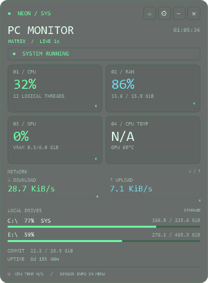
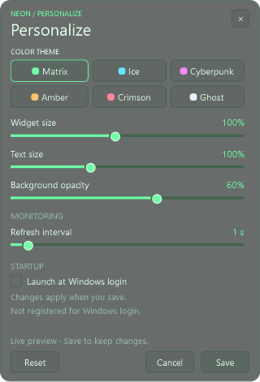

# NEON // PC Monitor

NEON is a desktop widget for 64-bit Windows 10/11. It stays behind your applications and shows live CPU, RAM, GPU, temperature, network, drive, and process readings. Its background, size, text, and colors are customizable. No account or cloud service is required.

  
  

## Get started

1. Download or clone this repository into a folder you can write to.
2. Double-click **Start.cmd**. The first launch builds NEON; later launches start `bin/NeonMonitor.exe` directly. Python, Node, and a separate SDK are not required. NEON uses .NET Framework 4.x, normally included with Windows 10/11.
3. Find the widget at the top-right of your desktop, behind your applications. Administrator privileges are not required.

## Use NEON

- Choose **Monitor**, **Processes**, or **Storage** from the tab row or **Tabs** menu. Monitor shows live system readings; Processes shows the top eight processes, sortable by CPU or memory. Storage is currently a placeholder for a future view.
- Drag **NEON / SYS** to move the widget. Use the **gear → Personalize…** menu to change size, text, theme, opacity, refresh interval, and Windows login startup. Click **Save** to keep changes or **Cancel** to discard them.
- Click **−** to hide the widget and double-click its notification-area icon to show it again. Click **×** or choose **Quit NEON** to exit.
- `N/A` means a reading is unavailable. CPU temperature may require a supported external sensor provider; see the [user guide](docs/user-guide.md#temperatures-and-gpu-sensors).

## If something goes wrong

- **No widget visible:** check the notification-area overflow and double-click NEON's icon. Other windows can cover the widget.
- **NEON does not start:** check that you are on 64-bit Windows 10/11 with .NET Framework 4.x, then inspect `bin/neon-error.log` if it exists.
- **Settings cannot be saved:** keep the repository in a writable folder. Settings are stored in `data/settings.json`.

See [troubleshooting](docs/troubleshooting.md) for sensor, startup, and build issues.

## Documentation

The [documentation index](docs/README.md) links to the full user guide, troubleshooting, development and verification, architecture, and roadmap. The `docs/` folder can also be opened as an Obsidian vault without plugins.
