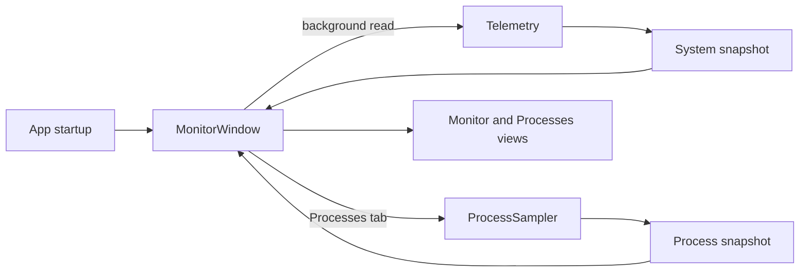

# Architecture

This map is for contributors and future agents. It records the current runtime path and where to make changes. Start with [development and verification](development.md) for build commands, the [user guide](user-guide.md) for visible behavior, and [troubleshooting](troubleshooting.md) for failure states.

At normal startup, `src/App.cs` establishes the single-instance mutex and reveal event, creates the WPF application, and opens `MonitorWindow`. Test and preview command-line modes branch before the normal UI startup. `MonitorWindow` owns the tabs, view layout, status, charts, menus, refresh timer, settings window, docking, and tray interactions. It calls `Telemetry.Read()` on a background task and applies its snapshot on the UI thread. Process sampling runs on a background task while Processes is selected; Monitor chart samples continue when another tab is visible. Storage has a tab entry and placeholder view only.

## Component map

Paths below are repository-relative names for finding code from the cloned repository. They are text rather than links because an Obsidian vault rooted at `docs/` cannot navigate to files outside that folder.

| Responsibility | Source | Verification |
| --- | --- | --- |
| Entry point, single instance, test/preview modes | `src/App.cs` | `tests/verify.ps1` and mode checks in `src/App.cs` |
| WPF widget, tabs, charts, alerts, menus, refresh, settings orchestration | `src/MonitorWindow.cs` | UI test mode in `src/MonitorWindow.cs`; `tests/verify.ps1` |
| CPU, RAM, network, fixed volumes, GPU and temperature providers; snapshot data | `src/Telemetry.cs` | Self-test mode in `src/App.cs`; `tests/verify.ps1` |
| Per-process collection, CPU deltas, PID reuse handling, ranking | `src/ProcessTelemetry.cs` | `tests/ProcessTests.cs` |
| Preferences, defaults, normalization, atomic JSON persistence | `src/Preferences.cs` | `tests/SettingsTests.cs` |
| Personalize window and live preview | `src/SettingsWindow.cs`, `src/DesktopSlider.cs` | `tests/SettingsTests.cs` and UI test mode |
| Current-user startup registration and Windows approval state | `src/StartupRegistration.cs`, `src/WindowsStartupRegistry.cs` | `tests/StartupTests.cs` |
| Desktop-level window placement and order | `src/DesktopLayer.cs` | `tests/DesktopLayerTests.cs` |
| Color palettes, WPF styles, and embedded icon | `src/Theme.cs`, `src/*Styles.xaml`, `src/BrandIcon.cs`, `assets/neon.svg` | UI and preview modes in `tests/verify.ps1` |

## State and external boundaries

- `MonitorWindow` loads preferences through `PreferencesStore` from `data/settings.json`. The settings window previews changes immediately and saves only on Save; Cancel restores the saved values. The file is local and ignored by Git.
- Windows login startup registration is separate from JSON preferences. `WindowsStartupRegistration` reads and writes the current user's registry value through `WindowsStartupRegistry`; tests and previews use a simulated service. A blocked or unknown Windows approval state is reported, not overridden.
- System CPU and RAM use Windows APIs. Network rates use interface counters and elapsed time; drives use fixed `DriveInfo` volumes. GPU and temperature information comes from supported NVIDIA or WMI providers. Unavailable readings remain unavailable rather than inferred.
- The widget remains behind normal applications through `DesktopLayer`. When its Explorer desktop layer is unavailable, it falls back to the bottom of the window order. It does not reparent Explorer windows.

When changing a visible feature, update the [user guide](user-guide.md) and its verification entry in [development](development.md). Record planned, unreleased behavior in the [roadmap](roadmap.md), not as current behavior.
